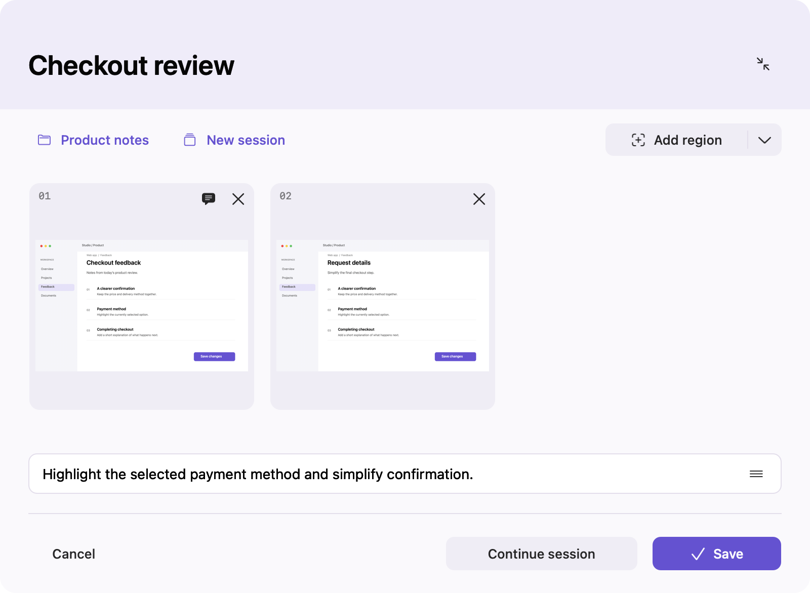

# Screenshot Note

A native macOS menu bar app for collecting screenshots and context into Markdown notes.

Capture an area or your screen, annotate images, add a title and a comment, and save the result to a folder or an Obsidian vault. Sessions have no fixed screenshot limit. No account or server is required. The interface follows your system language: Czech or English, with English as the fallback.

<picture>
  <source media="(prefers-color-scheme: dark)" srcset="docs/screenshots/capture-en-dark.png">
  
</picture>

## Features

- Area and full-screen capture with configurable global keyboard shortcuts.
- A horizontal screenshot strip without a fixed image limit, draft persistence, and a compact window mode.
- Per-image Markdown notes, displayed underneath each exported image.
- Annotations: selection, moving and deleting objects, arrows, shapes, freehand drawing, text styling, colors and crop.
- A single-line comment field with a larger editor that styles Markdown as you type.
- Separate local and cloud folders; local folders have their own export mode and Markdown template.
- Team cloud folders appear next to personal ones as `<Team> · <Folder>`; see [docs/LOCAL-CLOUD-FOLDERS.md](docs/LOCAL-CLOUD-FOLDERS.md#team-folders).
- Configuration selection and a separate menu action for reopening saved sessions.
- Separate notes per session or a shared Markdown file.
- Add screenshots to previously exported sessions, including sections of a shared note.
- Light and dark appearance, fullscreen-aware panels, and optional launch at login.

## Output

```text
Your folder/
  Note title.md
  assets/
    Note title_1.png
    Note title_2.png
```

Notes use Obsidian image links. Each configuration can customize the output layout using `{title}`, `{screenshots}` and `{text}` (optionally `{comments}`, `{context}` and, for cloud sessions, `{author}`). `{screenshots}` includes each image followed by its individual note. With the browser connection on, a capture of a frontmost Chromium browser stores the extension's context next to the image (`assets/<name>.context.json` and `assets/<name>.har`), adds a collapsible callout under the image and fills `{context}` with a per-session summary; cloud folders drop the context for now. Filenames remove diacritics and add a numeric suffix on collision. Existing files are not silently overwritten. New installations default to `~/Pictures/Screenshot Note`.

### Markdown template

Settings → Manage configurations → Markdown template opens the template editor. Save the configuration after editing. The default is:

```markdown
# {title}

# Screenshots

{screenshots}

# Description

{text}
```

Exported Markdown contains no hidden markers. The app remembers its sessions in an index in Application Support (plus an extended attribute on the file) and finds edited sessions by heading and image links. Changes to text inside the original layout can be reloaded; changing the template structure may prevent recognition. Older notes with `<!-- screenshot-note -->` comments stay readable; unmodified ones lose the comment once. Legacy notes using the earlier fixed headings remain discoverable. Switching sessions asks before transferring the current screenshots; the file is updated only when saving.

## Build

Requires macOS 13 or later, Python 3 and Xcode or the Xcode Command Line Tools. There are no third-party package dependencies.

```sh
./build.sh
```

The script compiles with Swift Package Manager (`Package.swift`) for the host architecture with a macOS 13 deployment target, assembles and signs the app bundle, verifies the signature and runs the regression checks. It prints the path to the completed app (`Vytvořeno:`) and to the test host (`Testy:`). Copy that app to `~/Applications` or `/Applications` and launch it.

Allow Screenshot Note in System Settings → Privacy & Security → Screen Recording when prompted.

The web origin is baked into the signed bundle; users cannot edit it in the app.
The default build is production, fixed to `https://screenshotnote.com`.
Use build-time variables for development:

```sh
SCREENSHOT_NOTE_ENV=local ./build.sh
# Defaults to http://localhost:5173; another loopback port can be set explicitly.
SCREENSHOT_NOTE_ENV=local SCREENSHOT_NOTE_WEB_ORIGIN=http://localhost:6000 ./build.sh
# Supply the actual test deployment origin; no test URL is assumed.
SCREENSHOT_NOTE_ENV=test SCREENSHOT_NOTE_WEB_ORIGIN=https://YOUR_TEST_HOST ./build.sh
```

Test builds require an explicit HTTPS origin separate from production. Production
rejects a custom origin. Runtime environment variables and old `cloudWebURL`
preferences do not change the destination. Keychain credentials are separated by
origin; production keeps its existing Keychain service for upgrade compatibility.
Outbox items retain their original owner and origin and cannot cross environments.
No backend feature is activated by selecting a build environment.

To use your own signing identity:

```sh
SIGNING_IDENTITY='your personal signing identity' ./build.sh
```

The default build uses an ad-hoc signature. Updating such a build can require renewing its screen-recording permission.

## Design and screenshots

[DESIGN.md](DESIGN.md) describes the palette, typography, spacing and shared components. Native window renders for both appearances are in [docs/screenshots](docs/screenshots).

Recreate the previews without capturing your screen:

```sh
/path/to/Screenshot\ Note.app/Contents/MacOS/ScreenshotNote --design-export ./docs/screenshots
```

## Verification

Tests are not part of the app binary. `./build.sh` builds the `ScreenshotNoteTestHost` target into a separate
`Screenshot Note Tests.app` (same Info.plist, resources, bridge helper and signature) and runs it:

```sh
"/path/to/Screenshot Note Tests.app/Contents/MacOS/ScreenshotNote" --self-test
"/path/to/Screenshot Note Tests.app/Contents/MacOS/ScreenshotNote" --folder-transfer-self-test
"/path/to/Screenshot Note Tests.app/Contents/MacOS/ScreenshotNote" --bridge-self-test
"/path/to/Screenshot Note Tests.app/Contents/MacOS/ScreenshotNote" --context-self-test
python3 tests/cloud-rest.py "/path/to/Screenshot Note Tests.app/Contents/MacOS/ScreenshotNote"
```

`tests/test-inventory.py` fails when test cases disappear or test code reaches the app sources.
The web flow test takes the same test host via `SCREENSHOT_NOTE_NATIVE_TEST_BINARY` (`--folder-sync-self-test`).

The checks cover filenames and collisions, export modes, persistent drafts, previous-session updates and stale-write protection, annotation rendering and crop, keyboard labels, dark appearance, compact mode and multi-image sessions.

## Source map

| File | Responsibility |
|---|---|
| `Package.swift` | Swift package: `BridgeWire`, `ScreenshotNoteKit`, app, bridge helper and test host |
| `Sources/ScreenshotNote/main.swift` | Thin executable calling `ScreenshotNoteApp.main()` |
| `Sources/ScreenshotNoteKit/App/AppDelegate.swift` | Menu bar app and capture workflow |
| `Sources/ScreenshotNoteKit/App/Launch.swift` | Launch flags, design export and single instance |
| `Sources/ScreenshotNoteTestHost/` | Regression checks (`main.swift`, cloud and bridge tests); never shipped |
| `Sources/ScreenshotNoteKit/Notes/CaptureNote.swift` | Drafts, filenames and Markdown export |
| `Sources/ScreenshotNoteKit/Cloud/CloudLibrary.swift` | Device pairing, REST uploads, persistent outbox and share links |
| `Sources/ScreenshotNoteKit/Cloud/CloudEndpoint.swift`, `CloudKeychain.swift`, `CloudTransport.swift`, `CloudModels.swift` | Build origin, Keychain credentials, HTTP transport and wire models |
| `Sources/ScreenshotNoteKit/Cloud/CloudFolders.swift`, `CloudFolderModels.swift` | Cloud folder sync and its models |
| `Sources/ScreenshotNoteKit/Settings/CloudSettings.swift` | Native cloud connection and retry controls |
| `Sources/ScreenshotNoteTestHost/Cloud*Tests.swift`, `TeamFolderTests.swift`, `ReviewFindingTests.swift`, `CloudTestSupport.swift` | Offline and loopback native cloud checks |
| `Sources/ScreenshotNoteKit/Capture/Composer.swift` | Capture window (incl. Copy link) |
| `Sources/ScreenshotNoteKit/Capture/ScreenshotPanel.swift`, `Hotkeys.swift` | Capture panels and global shortcuts |
| `Sources/ScreenshotNoteKit/Settings/SettingsController.swift`, `ShortcutSettings.swift` | Settings and shortcut editor |
| `Sources/ScreenshotNoteKit/UI/InterfaceSupport.swift` | Error alerts, labels and the editing menu |
| `Sources/ScreenshotNoteKit/Capture/SessionPicker.swift` | Configuration/session selection dialogs |
| `Sources/ScreenshotNoteKit/Capture/ImageNoteEditor.swift` | Per-image note dialog and Markdown expansion |
| `Sources/ScreenshotNoteKit/UI/CenteredFields.swift` | Centered text fields and window close actions |
| `Sources/ScreenshotNoteKit/Notes/Topics.swift` | Configuration model and editor |
| `Sources/ScreenshotNoteKit/Notes/PreviousSessions.swift` | Discovery and updates of exported sessions |
| `Sources/ScreenshotNoteKit/Annotations/Annotations.swift` | Editable image annotations, dirty-close confirmation and crop |
| `Sources/ScreenshotNoteKit/Annotations/AnnotationGeometry.swift` | Selection handles, object scaling and rotation |
| `Sources/ScreenshotNoteKit/Notes/MarkdownEditor.swift` | Comment editor and live text styling |
| `Sources/ScreenshotNoteKit/UI/Design.swift` | Shared visual components and semantic colors |
| `Sources/ScreenshotNoteKit/UI/DesignPreview.swift` | Reproducible native previews with synthetic data |
| `Sources/ScreenshotNoteKit/Localization/Localization.swift` | System-language resolution and string lookup |
| `Localizations/` | Native English and Czech translation catalogs |
| `Sources/ScreenshotNoteKit/App/About.swift` | Branded About window |

Preferences are stored using macOS UserDefaults. Unfinished drafts and editable annotation data are stored in `~/Library/Application Support/Screenshot Note`. Exported notes and images go only to the configured folders.

## Languages and About

Czech and English are selected automatically from system language preferences. Unsupported languages fall back to English. Existing user content and configuration names remain unchanged. Saved Czech and English Markdown notes are both discoverable as previous sessions. See [LOCALIZATION.md](LOCALIZATION.md) for translation details.

The About window is available from the menu bar, the application menu and Settings. It displays the app version and an overview of how notes are stored. Design previews include the About window and the compact state, in both languages and both appearances.

### 4.1.1

Single-line fields now vertically center text, including the active field editor. App windows use frameless rounded surfaces with background dragging and close or cancel controls inside the content.

### 4.1.2

Centered single-line labels alongside icons, and aligned the Settings header background with its divider.

### 4.1.3

Disabled the native blue focus ring in single-line text fields.

### 4.1.4

Removed horizontal rules at header-to-content transitions.

### 4.2

Title-first composer, configuration picker, unlimited screenshot strip, per-image notes and configurable Markdown templates. Add region/full-screen controls and capture shortcuts append to the open note after hiding its window. The composer has no session picker or Continue session button; the menu still reopens saved sessions. Verified with 12-image sessions, persisted caption remapping, mixed legacy/custom-template notes and external text edits.

### 4.2.1

Drawing and cropping consume mouse drags instead of moving the window. Tool cursors use an I-beam for text and a crosshair for drawing/crop. Inline annotation text has a transparent background and shares its font metrics with the exported image, including at scaled preview sizes. Text size and bold/italic/underline actions update the selected object and live editor; selection bounds follow the rendered text. Regression checks compare actual text pixels before and after editing at full and half scale.

### 4.2.2

Annotation toolbar: Undo on the far left, vertical separators around the drawing tools, and Close on the far right. Color appears only for text/drawing context; line width only for strokes/shapes. Text context shows font size and styling.

### 4.2.3

Configuration and session links size to their titles, capped at one third of the context row, with no chevrons or filled hover backgrounds. Both links stay left and the capture action stays right. Session thumbnails have more bottom padding.

### 4.2.5

Font-size and line-width menus now use a dedicated nested modal value picker, with explicit selection return instead of NSMenu action dispatch. Regression tests activate its real value buttons while the outer annotation panel is modal, verifying both font-size and stroke-width updates.

### 4.2.6

The menu groups capture, resume and folder actions above a separator, followed by Settings, About and Quit. Without an unfinished draft, Resume opens a session picker across configurations; saved images, captions and comments are loaded into an editable working copy without capturing the screen.

### 4.2.7

Drawing tools return to selection after creating an annotation; text returns after inline editing ends. The composer is 48 points shorter, reducing the gap between its context row and screenshot thumbnails to 24 points.

### 4.2.8

Added 24 points of clear space above the composer title, providing a 42-point area for dragging the frameless window.

### 4.2.9

Screenshot thumbnails reveal separate Annotation and Note icon actions on hover. Notes open a small dedicated dialog with a single-line field and an expand button for the Markdown editor. The annotation editor contains only image-editing controls. Existing image notes remain intact; note changes do not rewrite PNGs.

Saved sessions keep their original configuration. Its link is visible but disabled and dimmed; returning to New session enables configuration selection again.

### 4.3

Selected annotations have four corner handles for proportional resizing and a rotation handle above the object. Hold Shift while rotating to snap to 15-degree increments. Shapes, strokes, arrows and text retain editable transformations in working annotation data. Undo covers transformations as well as drawing and crop.

Closing an editor with changed annotations or crop offers Save, Discard changes or Cancel. Saving completes before the editor closes; a write failure leaves edits open for retry. Undo now uses a circular counterclockwise icon.

The default build runs only noninteractive regression checks and asserts that no test window became visible. Modal interaction checks are separate and opt-in:

```sh
"/path/to/Screenshot Note Tests.app/Contents/MacOS/ScreenshotNote" --self-test --interactive-ui-tests
```

The opt-in checks can open windows and take focus; run them outside normal desktop work. Native design exports remain offscreen.

### 4.3.1

Fixed Markdown link/code toolbar crashes caused by restoring text selection during an unfinished NSTextStorage attribute-edit transaction. Styling now preserves selection without setting it and no longer rerenders on every selection notification. Regression checks activate both toolbar actions on empty, selected and Unicode content, then force glyph layout and native drawing without showing windows.

### 4.3.2

Thumbnail actions expand to show their labels on hover. An annotated or captioned image shows its note button in the thumbnail header. The composer follows the pointer between displays. The Add region dropdown captures the full display under the pointer.

## License

Screenshot Note is available under the [MIT License](LICENSE).

## Cloud storage

Cloud Library connects this Mac through the Screenshot Note web pairing page.
Check the comparison code and account in your browser before approving. The
native credential is saved in Keychain. The app never asks for a Supabase key,
project URL or account password. The production build connects only to screenshotnote.com;
cloud pairing/uploads still require a separately activated server deployment.
Local notes work without an account.

Under Settings → Manage folders, local folders export on this Mac. Cloud folders
load from your connected account; optionally assign a different local download
directory on each Mac. Directories cannot be shared by two local/cloud entries.
Existing notes and notes added by other Macs download automatically into
`YYYY-MM-DD Title/YYYY-MM-DD Title.md` and `assets/`. Sessions trashed on the web move to `.trash/`. Local edits are preserved and are not
uploaded back. See [folder synchronization](docs/LOCAL-CLOUD-FOLDERS.md).

Cloud folder creation/rename requires the corresponding server migration and
feature activation; the source change does not activate the cloud backend.
Cloud notes first enter the durable outbox and materialize in the local download
directory after their upload is confirmed.
Cloud copies are converted to sRGB RGB/RGBA8 PNG, with at most 30 images and
100 MB per transfer; local-only sessions have no fixed image count limit.
Interrupted transfers remain in the owner-bound local outbox. Retry preserves
the same session ID and skips confirmed images. Older queued transfers remain
on disk and are not silently sent under a new account.
Transfers the server keeps rejecting, conflicting edits and queue entries of
another account are listed under Set Aside… (Cloud Library and the menu bar)
with Try Again, Save Locally and Discard. Cancelling or closing a note with
unsaved work asks first; the draft is backed up after every capture and
restored after a crash. Deleting a folder whose directory also holds other
files moves only Screenshot Note notes and images to the Trash.

Copy link appears in the note window for a saved session in a cloud folder of the
connected account once the server has it (not trashed). It creates or reuses the
session's public link and copies its URL to the clipboard; revoking links happens on the web.

Forget connection removes only local access. Revoke an active Mac in web
Settings. [Transport, tests and release acceptance](docs/CLOUD-REST.md) explain
the boundaries; [current implementation status](docs/PLAN.md) tracks the work.
No installer, production deployment or backend feature activation is included.
